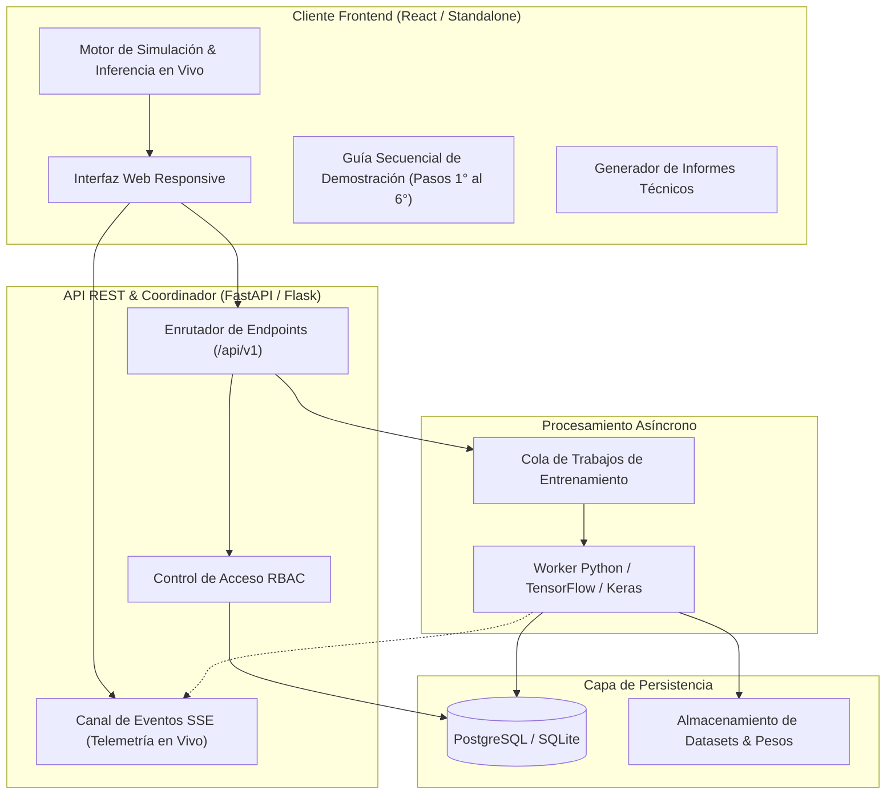
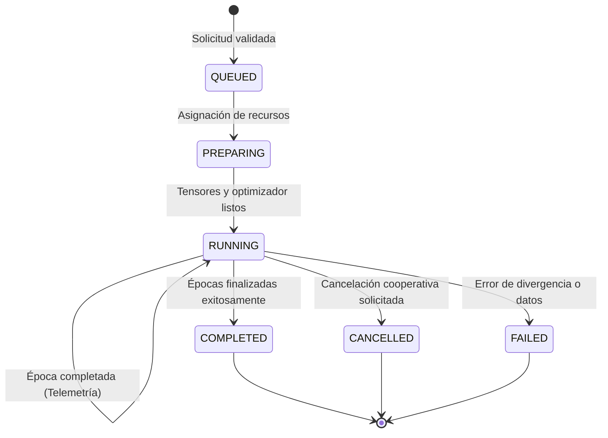

# NeuroLab Enterprise — Arquitectura del Sistema
**Plataforma Enterprise de Redes Neuronales Artificiales**  
*Aplicación práctica de las operaciones de la Semana 11*  
*Versión 1.0 — Octubre / Noviembre 2026*

---

## 1. Resumen Ejecutivo y Alcance
NeuroLab Enterprise es una solución integral diseñada para la concepción, entrenamiento, evaluación, versionado y gobierno de modelos de Deep Learning. El sistema transforma los requerimientos curriculares de la Semana 11 en una plataforma práctica y modular:
1. **Comprender la Red Neuronal:** Fichas conceptuales, neurona artificial interactiva, pesos, sesgos y funciones de activación (ReLU, Sigmoide, Softmax, Tanh).
2. **Definir Capas y Conexiones:** Constructor visual de arquitecturas con validación dimensional de `input_shape` y capas de salida.
3. **Reconocer Familias de Redes:** Catálogo con casos de uso para Feedforward (MLP), Convolucionales (CNN), Recurrentes (RNN/LSTM) y Generativas (GAN).
4. **Entrenar y Evaluar con TensorFlow/Keras:** Consola de ejecución, máquina de estados finitos, telemetría época por época y preservación del Test Set (15%) para evaluación imparcial.

---

## 2. Diagrama Lógico de Arquitectura

---

## 3. Las Dos Modalidades de Operación

### Modalidad A: Arquitectura Empresarial Backend (Python + PostgreSQL)
- **Frontend:** React + TypeScript + Vite.
- **API REST:** FastAPI / Flask versionado en `/api/v1` con validación de contratos mediante Pydantic.
- **Workers Desacoplados:** Tareas de TensorFlow/Keras aisladas en segundo plano con cancelación cooperativa.
- **Persistencia:** PostgreSQL para el modelo relacional de 9 entidades (proyectos, datasets, arquitecturas, jobs, métricas, modelos, auditoría).

### Modalidad B: Arquitectura Autónoma Client-Side (100% Standalone / Simulado)
- **Ejecución Local Inmediata:** Funciona directamente abriendo `apps/web/index.html` en cualquier navegador web moderno sin requerir compiladores o descargas externas.
- **Motor ML & Telemetría:** Simulación fiel del ciclo de entrenamiento, curvas de aprendizaje época por época y cálculo de matrices de confusión sobre el test set retenido.
- **Exportación Local:** Generación de informes formales para impresión o exportación a PDF y descargas en CSV y JSON.

---

## 4. Máquina de Estados de Entrenamiento

---

## 5. Ciclo de Vida del Registro de Modelos (Model Registry)
Los modelos se versionan de manera inmutable con un hash criptográfico SHA-256 para garantizar la trazabilidad:
1. **Borrador:** Modelo recién entrenado, en evaluación preliminar.
2. **En Revisión:** Sometido a análisis de métricas en el test set retenido.
3. **Aprobado:** Autorizado para uso en producción (requiere rol de `Revisor` o `Administrador`).
4. **Retirado:** Sustituido por una versión superior.
